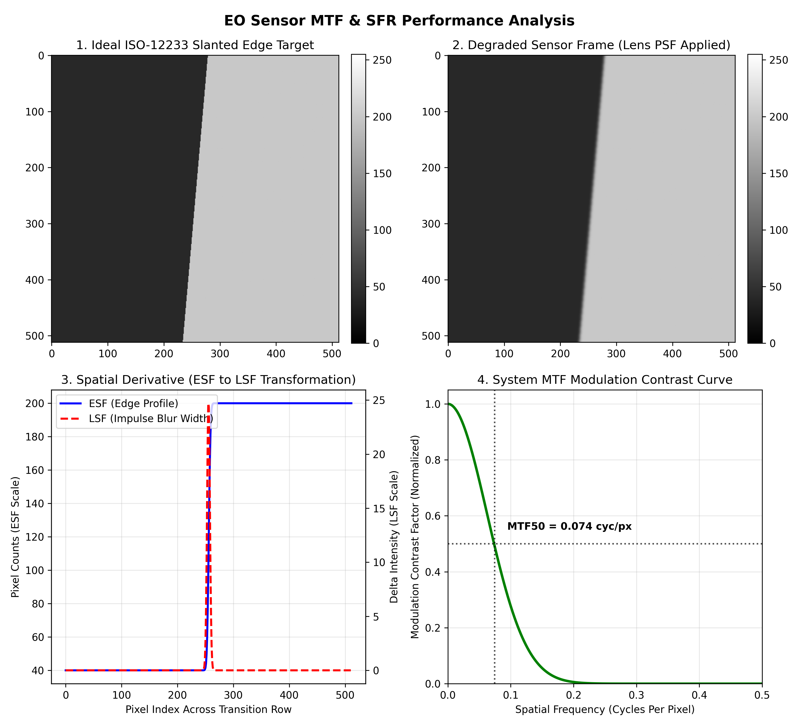

# Modulation Transfer Function & Spatial Frequency Response Simulator

## Technical Project Overview
This script acts as a verification and validation simulator, mapping how geometric aberrations, diffraction limits, or localized jitter degrade target resolution before downstream image processing algorithms are applied.

Implemented here is the industry-standard **ISO 12233 slanted edge method** to oversample a system's **Spatial Frequency Response (SFR)**, mathematically calculating the **Modulation Transfer Function (MTF)** to quantify lens contrast degradation.

## Mathematical Architecture & Processing Chain

1. **Slanted Edge Target Generation:** Constructs a high-contrast geometric interface rotated at a 5-degree angle. The sub-pixel tilt forces a continuous phase shift across the pixel grid, actively mitigating pixel-phase aliasing limits.
2. **Point Spread Function (PSF):** Simulates physical lens blur, diffraction constraints, or atmospheric jitter by convolving the spatial scene with a Gaussian blur matrix.
3. **Edge Spread to Line Spread Transformation:** Extracts the raw center transition vector row (the Edge Spread Function, or ESF). The algorithm computes the spatial derivative ($\Delta$ Intensity / $\Delta$ Pixel) across the edge array to isolate the **Line Spread Function (LSF)**, tracking the system's spatial impulse response.
4. **Fast Fourier Transform (FFT) Modulation Mapping:** Executes a Forward 1D Real FFT on the padded LSF matrix. The magnitude spectrum is normalized to 1.0 at DC (0.0 frequency) to output the finalized MTF curve up to the sensor's physical Nyquist frequency limit (0.5 cycles/pixel).

## Key Laboratory Performance Metrics
The diagnostic dashboard automatically isolates the **MTF50 Threshold**—the critical spatial frequency where the modulation contrast response drops exactly to 50%. In electro-optical payload validation, MTF50 is the industry benchmark used to calculate true target recognition distances and sensor resolving power.
